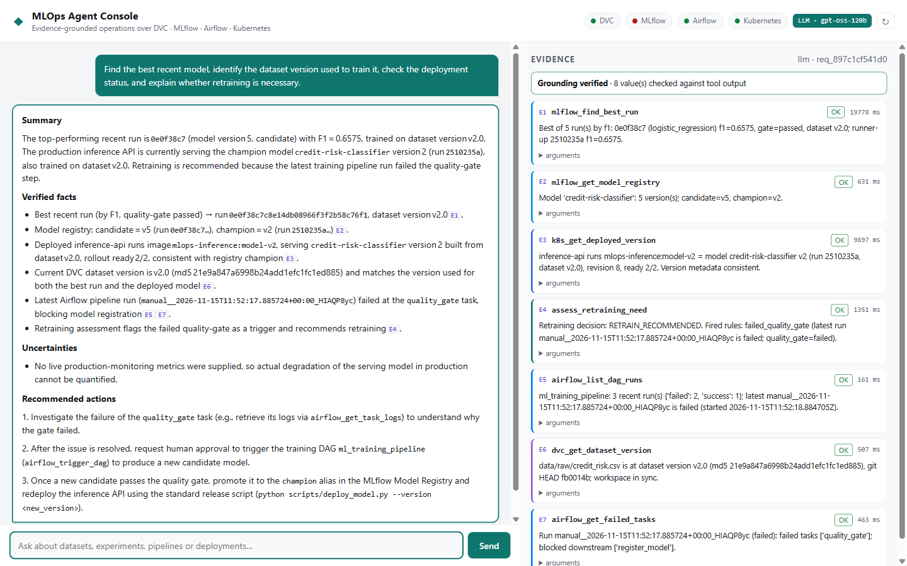

# MLOps AI Agent

[](https://github.com/Ahmed-Ijaz-A/MLOPS-AI-Agent/actions/workflows/ci.yml)

A conversational agent that operates a real ML system. It answers questions and runs approved
operations across **DVC** (dataset versions), **MLflow** (experiments and model registry),
**Apache Airflow 3** (training pipeline) and **Kubernetes** (the inference API). Every claim it makes
is backed by a tool result it actually received.

> "Find the best recent model, identify the dataset version used to train it, check the deployment
> status, and explain whether retraining is necessary."
>
> The agent queries all four systems, correlates the evidence, applies an explicit retraining policy,
> and answers with **verified facts** (each cited `[E#]`), **uncertainties**, and **recommended actions**.
> See [the recorded conversation](docs/conversations/05-multi.md).



## Highlights

| | |
|---|---|
| **33 tools** across 4 systems + a policy engine | [docs/TOOLS.md](docs/TOOLS.md) (generated from the code) |
| **Evidence-grounded answers** | every value is cited `[E#]`; a grounding verifier flags any number or id no tool returned |
| **Human-in-the-loop writes** | trigger / restart / scale / rollback create one-time, expiring, argument-bound approvals; namespace, DAG and replica limits are enforced in code |
| **Web console** | chat, live evidence trace, Approve/Decline cards, live integration health |
| **Any LLM** | Claude (Anthropic SDK) or any OpenAI-compatible provider (Cerebras, Gemini, Groq, Mistral, OpenRouter), plus a deterministic offline mode that needs no key |
| **Real ML lifecycle** | credit-risk model on OpenML `credit-g`, DVC versions v1.0 / v2.0, Airflow DAG with a quality gate, MLflow registry aliases, hardened K8s deployment |
| **287 tests, 84 % coverage** | real temporary git+DVC repos and MLflow stores, fake K8s / Airflow / LLM; CI also deploys to a kind cluster |
| **Live evidence** | 8 recorded scenarios against the running stack, including 3 failure investigations, in [docs/conversations](docs/conversations) |

Read next: [architecture.md](architecture.md) · [technical report](docs/REPORT.md) · [tool reference](docs/TOOLS.md)

---

## 1. Prerequisites

| Tool | Version used | Notes |
|---|---|---|
| Python | 3.12 | 3.11+ works |
| Docker Desktop | 29.x | with **Kubernetes enabled** (Settings → Kubernetes). ~20 GB free disk |
| kubectl | 1.30+ | ships with Docker Desktop |
| git | 2.4x | |
| LLM key (optional) | | any one of: Anthropic, Cerebras (free), Gemini, Groq, Mistral, OpenRouter. Without one, the agent runs in offline mode |

Commands below are for PowerShell on Windows. On macOS/Linux use `.venv/bin/` instead of `.venv\Scripts\`.

## 2. Install

```powershell
git clone https://github.com/Ahmed-Ijaz-A/MLOPS-AI-Agent.git
cd MLOPS-AI-Agent
python -m venv .venv
.venv\Scripts\pip install -e ".[dev]"
copy .env.example .env
```

## 3. Configure (`.env`)

`.env` is git-ignored. Never commit it.

| Variable | Purpose |
|---|---|
| `LLM_PROVIDER` | `auto` (default), `anthropic`, `cerebras`, `gemini`, `groq`, `mistral`, `openrouter` or `offline` |
| `CEREBRAS_API_KEY` / `ANTHROPIC_API_KEY` / ... | key for the chosen provider (`auto` uses the first key it finds) |
| `LLM_MODEL` | optional model override (defaults: `claude-opus-5-5`, `gpt-oss-120b` on Cerebras, ...) |
| `AIRFLOW_PASSWORD`, `AIRFLOW_JWT_SECRET` | choose random values. Docker Compose creates the Airflow user from them |
| `MLFLOW_TRACKING_URI`, `AIRFLOW_BASE_URL` | defaults `http://localhost:5000`, `http://localhost:8080` |
| `KUBE_CONTEXT` | e.g. `docker-desktop` |
| `AGENT_API_KEY` | optional. If set, `/api/*` requires the `X-API-Key` header |

## 4. Launch each service

```powershell
# 4.1 Dataset versions (one-time): DVC init + v1.0 and v2.0 as git commits/tags, pushed to the DVC remote
.venv\Scripts\python scripts\bootstrap_data_versions.py
#   (on an existing clone, `dvc pull` restores the data instead)

# 4.2 MLflow + Airflow 3 (Postgres, api-server, scheduler, dag-processor, triggerer)
docker compose -f infra/docker-compose.yml --env-file .env up -d --build
#   MLflow  -> http://localhost:5000      Airflow -> http://localhost:8080 (AIRFLOW_USERNAME / AIRFLOW_PASSWORD)

# 4.3 Experiment history: 3 model types x 2 dataset versions, gate + registration
.venv\Scripts\python scripts\seed_experiments.py

# 4.4 Release a gate-passing model to Kubernetes (promotes it to 'champion', builds the image, rolls out)
.venv\Scripts\python scripts\deploy_model.py --version 2
kubectl -n mlops-agent get pods,svc

# 4.5 The agent
.venv\Scripts\python -m uvicorn api.main:app --port 8000      # web console -> http://localhost:8000
```

The DVC pipeline is reproducible on its own: `dvc repro` rebuilds the processed data, the model and
`reports/metrics.json` (F1 0.6575, the same as the deployed champion).

## 5. Use the agent

**Web console**: open http://localhost:8000, then click a suggested scenario or type a question. Click
an `E#` chip to jump to its evidence. Approve or decline pending actions on the right.

**CLI**

```powershell
.venv\Scripts\python -m agent.main "Why is my prediction API unavailable?"
.venv\Scripts\python -m agent.main                 # interactive session; approvals prompt y/N
.venv\Scripts\python -m agent.main --offline "..." # deterministic planner, no LLM
.venv\Scripts\python -m agent.main --json "..."    # raw response with trace and grounding report
```

**HTTP API**

```powershell
curl -X POST localhost:8000/api/chat -H "content-type: application/json" `
     -d '{"message": "Compare the last five training runs and recommend the best candidate based on F1 score."}'
curl localhost:8000/api/confirmations                         # pending approvals
curl -X POST localhost:8000/api/confirmations/<id> -H "content-type: application/json" -d '{"approve": true}'
curl localhost:8000/api/tools                                 # catalog with permissions
curl localhost:8000/api/integrations                          # live health of the 4 systems
curl localhost:8000/api/audit                                 # approval audit trail
```

Example questions:

- *Which dataset version was used to train the champion model, and how do I reproduce it?*
- *Compare the last five training runs and recommend the best candidate based on F1 score.*
- *Trigger the model training pipeline and report whether execution succeeded.*
- *Why is my prediction API unavailable?* · *Roll the inference-api deployment back.*
- *Find the best recent model, identify the dataset version used to train it, check the deployment status, and explain whether retraining is necessary.*

## 6. Tests and CI

```powershell
.venv\Scripts\ruff check . ; .venv\Scripts\ruff format --check .
.venv\Scripts\python -m pytest --cov            # 287 tests, ~2 min, no services needed
```

The tests cover tool selection and execution, multi-tool reasoning, timeouts, invalid requests,
service failures, a test proving the agent does not invent results when a tool is unavailable,
rejection of unauthorized Kubernetes changes, approval tokens, log redaction, the training pipeline,
the inference API, the DAG structure, and the manifests.

[`.github/workflows/ci.yml`](.github/workflows/ci.yml) runs on every pull request and push to `main`:

| Job | What it proves |
|---|---|
| `lint` | ruff lint + format |
| `test` | full suite with a coverage gate (75 %) |
| `training-smoke` | builds dataset v2.0 from OpenML and runs the real pipeline |
| `dag-integrity` | the DAG parses in real Airflow 3.1 with the expected tasks, dependencies and retries |
| `manifests` | kubeconform (strict) on the rendered kustomization |
| `docker-and-kind` | builds the inference image, smoke-tests it, deploys to a kind cluster, then has the agent diagnose the live deployment |

External services are mocked in ordinary CI runs. Only the kind job talks to a real (ephemeral) cluster.

## 7. Demonstrations and failure injection

```powershell
.venv\Scripts\python scripts\run_demos.py            # re-records all 8 scenarios into docs/conversations/
.venv\Scripts\python scripts\inject_failure.py bad-config   # CrashLoopBackOff (ConfigMap points at a missing model)
.venv\Scripts\python scripts\inject_failure.py bad-image    # ImagePullBackOff
.venv\Scripts\python scripts\inject_failure.py restore
```

Pipeline failures are injected through the DAG's run configuration, for example: *"Trigger the training
pipeline with the low_quality failure injection"* (the quality gate fails and nothing is promoted).

## 8. Repository layout

```
agent/            orchestrator, LLM providers, offline planner, grounding, safety, schemas, CLI
  tools/          dvc_tools, mlflow_tools, airflow_tools, kubernetes_tools, insight_tools, base (executor)
api/              FastAPI service + web console (static/)
dags/             training_pipeline.py (Airflow 3)
training/         data versions, pipeline stages, MLflow tracking, provenance, CLI
serving/          inference API (deployed to Kubernetes)
kubernetes/       namespace, configmap, deployment, service, PDB, RBAC, kustomization
infra/            docker-compose (MLflow + Airflow 3), custom images
config/           agent_policy.yaml - every permission the agent has
scripts/          bootstrap data, seed experiments, deploy model, inject failures, run demos, gen docs
tests/            287 tests
docs/             REPORT.md, TOOLS.md, conversations/ (live transcripts), evidence/ (exports)
screenshots/      console, MLflow, Airflow
dvc.yaml  dvc.lock  params.yaml  Dockerfile  pyproject.toml  architecture.md
```

## 9. Troubleshooting

| Symptom | Fix |
|---|---|
| Docker build fails with `input/output error` | the disk is full; free ~20 GB, then restart Docker Desktop |
| A status pill shows `timeout` right after start-up | first import of mlflow/kubernetes is slow; the API warms clients in the background, so refresh after ~20 s |
| `UnicodeEncodeError` in a Windows terminal | already handled in the CLI; for other scripts set `PYTHONUTF8=1` |
| Gemini returns 403 "free tier is not available" | regional restriction on the Google project; use another provider (e.g. Cerebras) |
| `dvc repro` says `No module named joblib` | run it with the venv on PATH (`.venv\Scripts\activate`) |
