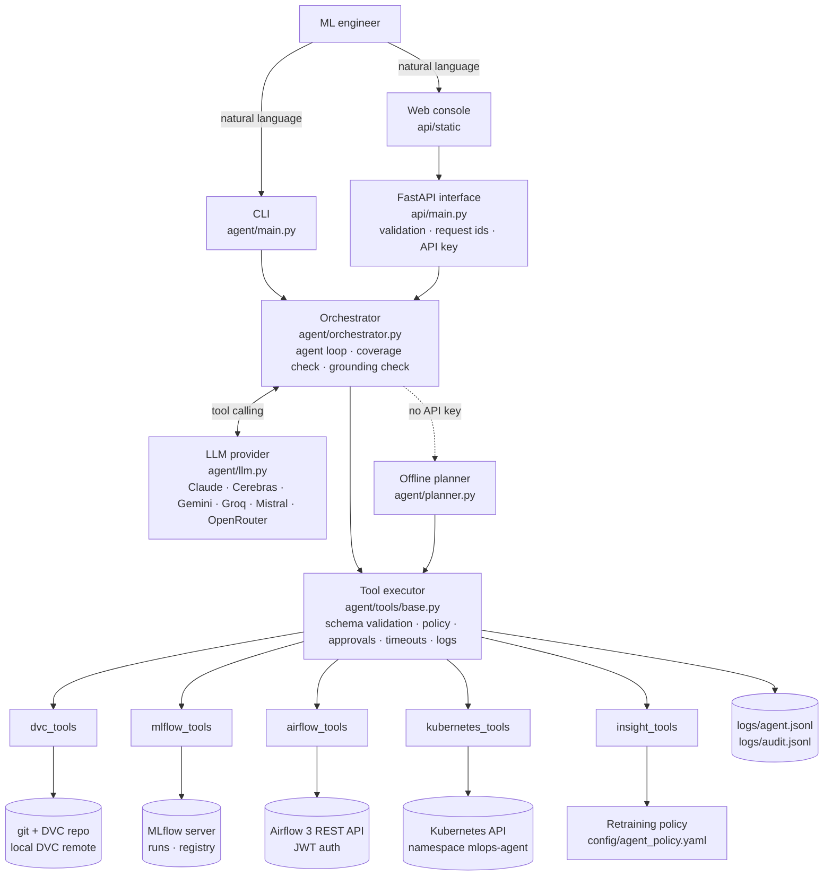
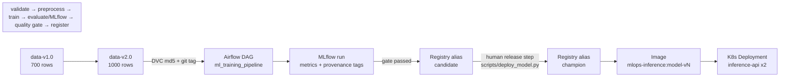
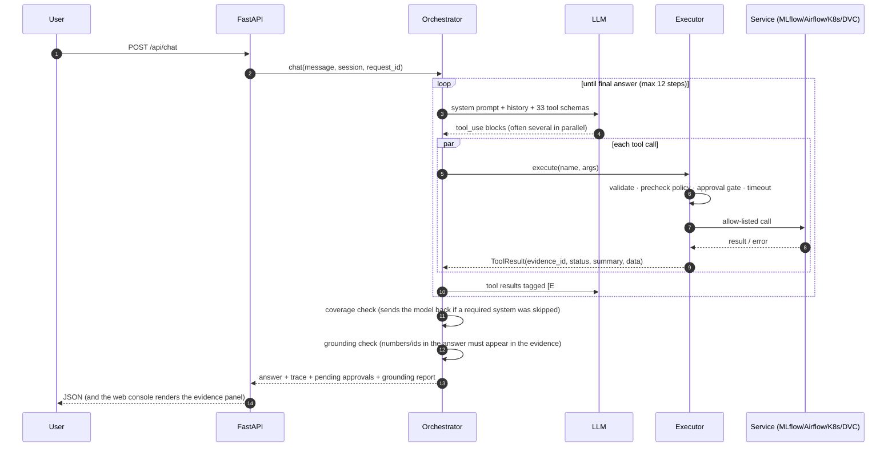

# Architecture

This document explains how the MLOps agent is put together, why it is built that way, and where each
responsibility lives in the code.

## 1. System context

The agent never answers from model memory. Every operational fact in an answer comes from a tool result,
which gets an evidence id (`E1`, `E2`, ...) that the answer cites. After the answer is written, a
grounding verifier checks every number and identifier in it against the raw tool output.

## 2. ML lifecycle the agent operates on

| Stage | What is recorded | Where the agent reads it |
|---|---|---|
| Dataset version | `.dvc` md5 per git commit, tags `data-v1.0`, `data-v2.0` | `dvc_get_dataset_version`, `dvc_list_dataset_versions` |
| Training run | metrics, params, tags `dataset.md5`, `dataset.version`, `git.commit`, `quality_gate.status`, `airflow.run_id` | `mlflow_*`, `dvc_resolve_run_dataset` |
| Promotion | registry aliases `candidate` (gate passed) and `champion` (human-approved release) | `mlflow_get_model_registry` |
| Deployment | image tag, label `app.kubernetes.io/version`, annotations `mlops.agent/model-version`, `model-run-id`, `dataset-version`, ConfigMap `MODEL_VERSION` | `k8s_get_deployed_version` (also checks all of these against the champion alias) |

Provenance is end to end. From a running pod, the agent can get to the model version, then the MLflow
run, then the dataset md5, then the git commit, then the `data-vX` tag. It can then rebuild those exact
bytes with `dvc_reproduce_dataset`, which checks the checksum.

## 3. Request lifecycle

## 4. Components

| Concern | File(s) | Notes |
|---|---|---|
| HTTP interface | `api/main.py`, `api/static/*` | Request-id middleware, optional `X-API-Key`, background warm-up, parallel health probes, web console |
| Agent loop | `agent/orchestrator.py` | Manual tool-calling loop, parallel tool execution, coverage check, session memory, citation normalisation |
| LLM providers | `agent/llm.py`, `agent/config.py` | Anthropic SDK for Claude; an OpenAI-compatible adapter for Cerebras / Gemini / Groq / Mistral / OpenRouter (keeps Gemini thought signatures); `LLM_PROVIDER=auto` picks a provider from whichever key is present |
| Offline mode | `agent/planner.py` | Deterministic intent → tool plan, answer built only from tool summaries. Used when no key is configured and in CI |
| Tool executor | `agent/tools/base.py` | The single choke point: validation, policy, approvals, timeouts, error taxonomy, redaction, structured logs |
| Safety | `agent/safety.py`, `config/agent_policy.yaml` | Allowlists, one-time SHA-256-bound confirmation tokens, append-only audit log |
| Grounding | `agent/grounding.py` | Flags any decimal, percentage, hash or commit in the answer that no successful tool returned |
| Tools | `agent/tools/{dvc,mlflow,airflow,kubernetes,insight}_tools.py` | 33 tools; reference in [docs/TOOLS.md](docs/TOOLS.md) |
| Training | `training/*.py`, `dvc.yaml`, `params.yaml` | Shared by the DAG, `dvc repro` and the CLI, so the gate logic is identical everywhere |
| Orchestration | `dags/training_pipeline.py` | Airflow 3 Task SDK; retries; fail-fast on deterministic failures; failure-injection params |
| Serving | `serving/app.py`, `Dockerfile`, `kubernetes/*.yaml` | FastAPI model server, probes, Prometheus counters, hardened manifests |
| Platform | `infra/docker-compose.yml` | Postgres, MLflow, Airflow api-server / scheduler / dag-processor / triggerer |

## 5. Safety model

The safety rules are enforced in code, so they hold no matter what the LLM says.

1. **Least privilege by default.** 29 of 33 tools are read-only. The 4 write tools are
   `airflow_trigger_dag` (operate) and `k8s_restart/scale/rollback_deployment` (mutate).
2. **Policy before approval.** Forbidden requests are denied outright and never offered for approval.
   This covers a wrong namespace, an unlisted deployment or DAG, replicas outside 1–5, and unknown conf
   keys (`precheck` in each `ToolSpec`).
3. **Human approval for every write.** A write tool returns `requires_confirmation` with a one-time
   token. The token expires after 10 minutes, belongs to one session, and is bound to a SHA-256
   fingerprint of the exact arguments. Only `POST /api/confirmations/{id}` or the CLI's y/N prompt can
   execute it, and the model has no tool that approves anything.
4. **Allow-listed processes.** DVC and git run without a shell and only with approved sub-commands.
   `push`, `gc`, `remove`, `checkout`, `reset` and shell metacharacters are refused before any process
   starts.
5. **Defence in depth on the cluster.** A namespaced Role (no delete, exec or secrets), a `restricted`
   Pod Security level, a non-root read-only container, a PDB, and `maxUnavailable: 0` rollouts.
6. **Secrets.** Secrets come only from environment variables. Logs, tool output and the audit trail
   redact keys, bearer tokens, JWTs and passwords.

## 6. Design decisions

| Decision | Alternatives | Why |
|---|---|---|
| Own agent loop instead of a framework | LangChain / LangGraph, SDK tool runner | The loop is where approvals, coverage, grounding and tracing live; ~200 lines of explicit code are easier to defend and test than framework callbacks |
| Provider-agnostic LLM layer | Single vendor | Free-tier availability differs by region (the Gemini free tier was blocked for this project, so Cerebras is used); the agent's behaviour does not depend on the vendor |
| Deterministic offline planner | Fail without a key | CI and graders can run every scenario without credentials; it is also the fallback when the LLM API is down |
| Deterministic retraining policy tool | Let the LLM decide | "Should we retrain?" is answered by explicit, auditable rules (freshness, min F1, data change, failed gate, supplied degradation). The LLM explains the result; it doesn't invent the decision. Failure-injection drills are excluded |
| Rule-based Kubernetes diagnosis | Raw dumps to the LLM | Classifies ImagePullBackOff, CrashLoop, OOMKilled, failing probes, scheduling failures, ConfigMap↔crash-log correlation, and zero endpoints, with evidence and a suggested fix for each, so even small models diagnose correctly |
| `skops` model serialisation (MLflow 3 default) | pickle | No arbitrary code execution on load; only `sklearn.tree._tree.Tree` is explicitly trusted |
| Model baked into the image | Load from MLflow at start-up | The serving pods have no runtime dependency on MLflow; the image tag *is* the model version, which makes rollbacks atomic |
| Real dataset with two versions | Toy data | `credit-g` (OpenML) gives realistic, distinguishable metrics: gradient boosting fails the quality gate on its own, without injection |
